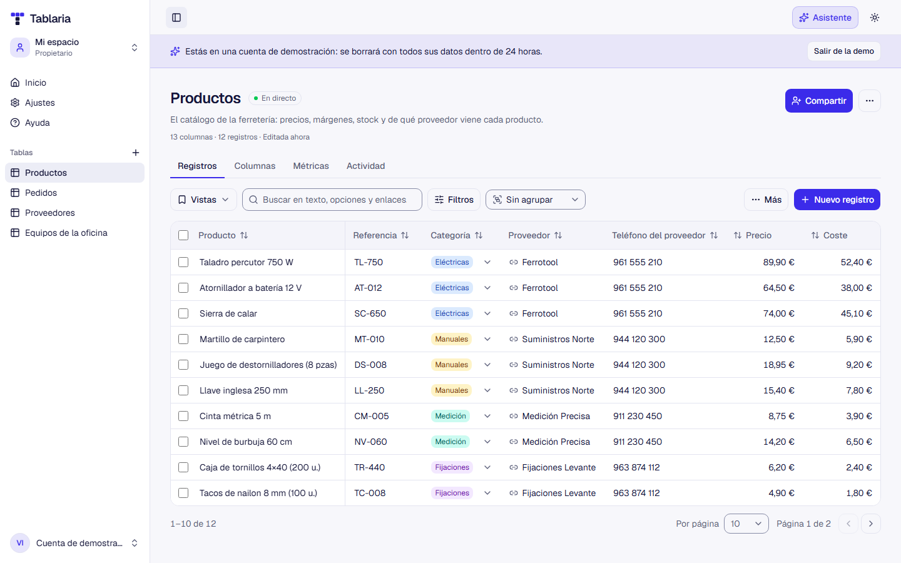
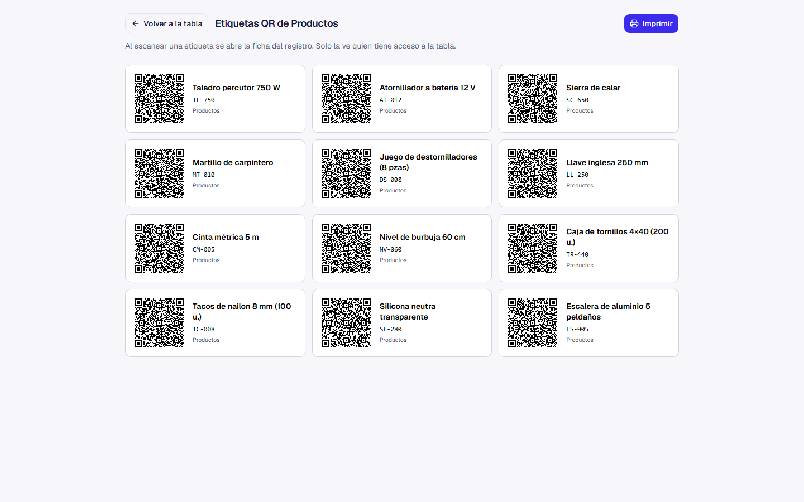
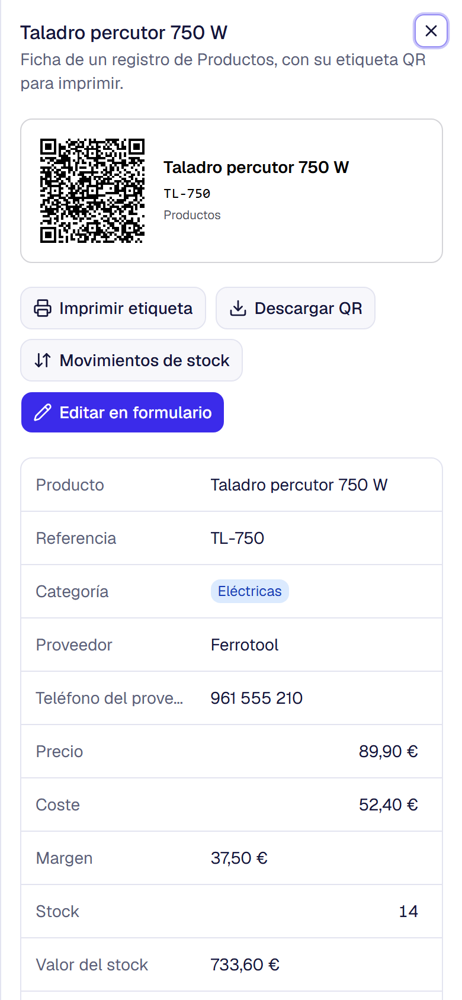
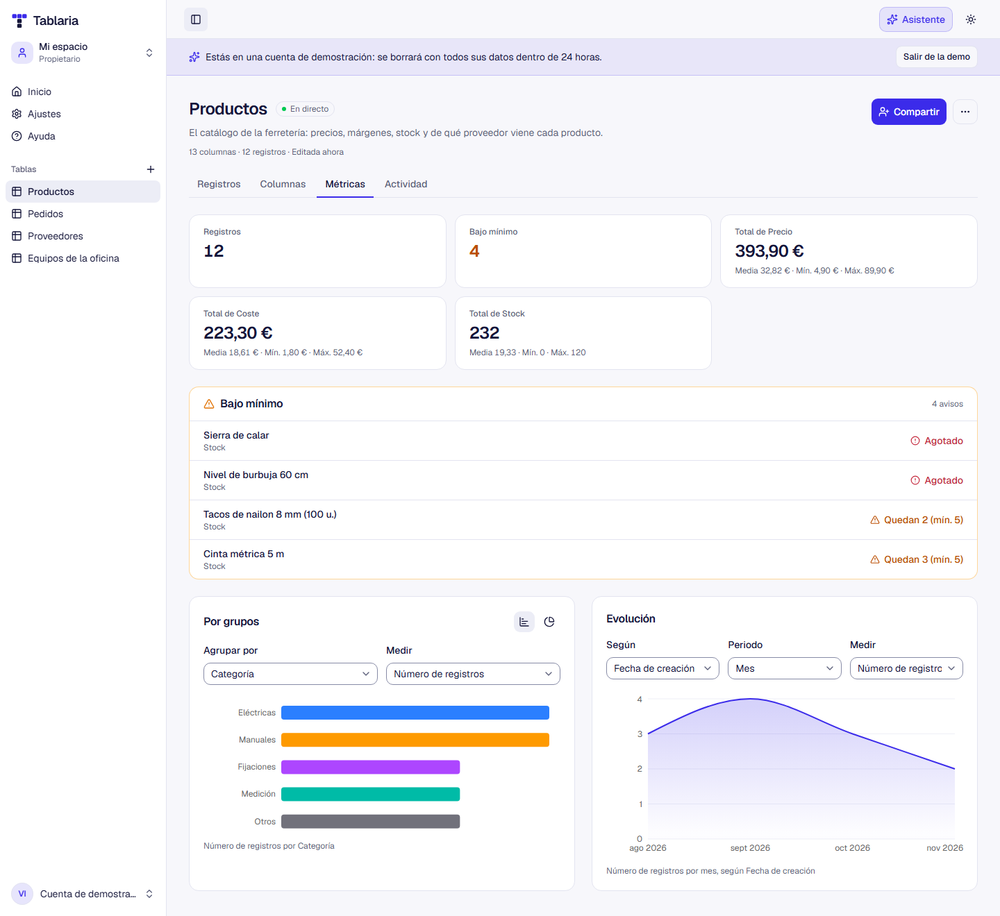

# Tablaria

[](https://github.com/JonathanTWD/tablaria/actions/workflows/ci.yml)
[](LICENSE)

Gestión de inventario flexible: cada usuario crea sus propias tablas, define columnas con tipo y trabaja con sus registros como en una hoja de cálculo, pero con validación, búsqueda, filtros y orden en el servidor. Las tablas se comparten por email o dentro de organizaciones, y los cambios se ven en directo.

**Demo en directo: [tablaria.es](https://tablaria.es).** Pulsa «Probar la demo» y entrarás sin registrarte en una cuenta temporal con tablas de ejemplo, que se borra a las 24 h.



## Funcionalidades

- **Cuentas**: registro con verificación por email, inicio de sesión, recuperación de contraseña y sesiones con cookies httpOnly y refresh tokens rotatorios.
- **Tablas**: crear en blanco o desde plantilla (inventario básico, catálogo de productos, equipos y activos), renombrar y borrar.
- **Columnas** de seis tipos: texto, número, fecha, sí/no, lista de opciones con colores y precio en cualquier moneda. Se pueden marcar como obligatorias, tener valor por defecto, reordenarse y cambiar de tipo convirtiendo los valores guardados.
- **Registros**: edición directa en la celda (Enter guarda, Escape cancela), formulario completo, búsqueda, filtros por tipo, orden y paginación. La vista vive en la URL, así que se puede compartir. Varios registros se pueden seleccionar para cambiarles un valor o borrarlos a la vez, y cada combinación de búsqueda, filtros y orden se puede guardar como una vista con nombre.
- **Exportar, importar y avisos**:
  - exportación de la vista actual a Excel (.xlsx, con números, precios y fechas de verdad) o a CSV;
  - importación de Excel o CSV con un asistente que empareja columnas y valida cada celda antes de guardar nada;
  - alertas de stock bajo por columna y resumen con gráfico de barras.
- **Compartir y organizaciones**: invitar por email a una tabla como lector o editor, u organizaciones con miembros y roles (lector, editor, administrador y propietario) que ven todas sus tablas. Las invitaciones caducan, son de un solo uso y tienen límites contra el spam.
- **Tiempo real y presencia**: los cambios de otras personas aparecen sin recargar, y se ve quién tiene la tabla abierta y qué celda está editando.
- **Etiquetas QR** para imprimir y pegar: al escanearlas se abre la ficha del registro.
- **Adjuntos**: fotos y PDF en la ficha de cada registro, guardados en un bucket privado compatible con S3.
- **Asistente de IA**: preguntas sobre los datos, por escrito o con voz («¿qué está bajo mínimo?»), respondidas por un modelo de Groq que consulta las tablas con herramientas de solo lectura y los permisos del usuario.
- **Métricas de cada tabla**: totales y medias, registros bajo mínimo, gráficos por grupos (barras o dona) y evolución en el tiempo.
- **Dashboard** con cifras generales, tablas recientes y selector de espacio, tema claro u oscuro, interfaz en español preparada para más idiomas y diseño adaptado a móvil y a pantallas grandes.
- **Demo pública** con cuentas temporales: una ferretería con productos, proveedores y pedidos enlazados, con consultas, resúmenes, fórmulas, historial de stock y actividad, y una organización con compañeros ficticios.

## Un caso de uso: etiquetas QR en el almacén

Una ferretería tiene su catálogo en una tabla de productos: referencia, ubicación, stock, stock mínimo y proveedor.

1. **Imprime las etiquetas.** Con «Etiquetas QR» filtra por un pasillo e imprime la hoja en papel adhesivo. Cada etiqueta lleva el QR, el nombre y la referencia.
2. **Las pega en las estanterías**, cada una en el hueco de su producto.
3. **Escanea con el móvil** cuando lo necesita: se abre la ficha del producto con su stock, su proveedor y su precio.
   - Para **reponer**, registra la entrada en los movimientos de stock desde la misma ficha.
   - Para **hacer inventario**, recorre las estanterías comparando el stock de cada ficha con lo que hay.

El QR solo lleva el enlace, no los datos. Si alguien ajeno escanea una etiqueta, le pide iniciar sesión y no ve nada.

| Hoja de etiquetas para imprimir | Ficha al escanear, en el móvil |
|---|---|
|  |  |

El mismo esquema sirve para los equipos de una oficina (a quién está asignado cada portátil), material que se presta o las cajas de un trastero.

### Métricas de cada tabla



## Stack

| Paquete | Tecnologías |
|---|---|
| `tablaria-frontend/` | React 19, TypeScript, Vite, React Router, TanStack Query y Table, react-hook-form, Tailwind CSS 4, shadcn/ui (Base UI), react-i18next |
| `tablaria-backend/` | NestJS 11, TypeScript, Prisma 7, PostgreSQL 16, zod |
| `packages/shared/` | Esquemas zod, tipos y constantes compartidos por frontend y backend |
| `e2e/` | Playwright |

Los valores de los registros se guardan en JSONB, indexados por el id de la columna. Las consultas de búsqueda, filtro y orden son SQL parametrizado, construido solo con columnas que existen en la tabla. Las decisiones de diseño están explicadas en [docs/DECISIONS.md](docs/DECISIONS.md).

El diagrama [docs/arquitectura.html](docs/arquitectura.html) muestra cómo encajan la web, la API, la base de datos y los servicios externos (descárgalo y ábrelo en el navegador).

## Probarlo con Docker (todo incluido)

Solo necesitas Docker. Levanta la base de datos, aplica las migraciones y arranca la API y la web detrás de nginx:

```bash
cp .env.prod.example .env.prod
# Rellena POSTGRES_PASSWORD y JWT_ACCESS_SECRET (el archivo explica cómo generarlos)
docker compose -f docker-compose.prod.yml --env-file .env.prod --profile mailpit up -d --build
```

- **Tablaria**: http://localhost:8080
- **Correos** (verificación de cuenta, recuperación de contraseña): http://localhost:8025, gracias a Mailpit (`--profile mailpit`). Para enviar correos de verdad, configura `MAIL_TRANSPORT=resend` y `RESEND_API_KEY`.

La web y la API comparten origen: nginx sirve la aplicación y redirige `/api` a la API, así las cookies de sesión funcionan sin configurar CORS.

Las cookies de sesión son `Secure`: funcionan con HTTPS y en `http://localhost`. Para servirlo por HTTP desde otro equipo de tu red, pon `COOKIE_SECURE=false` en `.env.prod`.

## Desarrollo

Requisitos: Node.js ≥ 22.22, pnpm 10 (`corepack enable`) y Docker.

```bash
cp .env.example .env
cp tablaria-backend/.env.example tablaria-backend/.env
# Rellena JWT_ACCESS_SECRET en tablaria-backend/.env
docker compose up -d                          # PostgreSQL y Mailpit
pnpm install
pnpm --filter tablaria-backend db:migrate
pnpm dev
```

| Servicio | URL |
|---|---|
| Frontend | http://localhost:5173 |
| API (a través del proxy de Vite) | http://localhost:5173/api |
| API (directa) | http://localhost:3000/api |
| Mailpit | http://localhost:8025 |
| PostgreSQL | `127.0.0.1:5433` (usa la IP: el puerto solo escucha en IPv4) |

El frontend llama siempre a rutas relativas `/api/...`. En desarrollo Vite las redirige a la API (`API_PROXY_TARGET`) y en producción lo hace nginx.

### Scripts (raíz)

| Script | Descripción |
|---|---|
| `pnpm dev` | Compila `shared` y arranca todos los paquetes en modo desarrollo |
| `pnpm build` | Compila `shared`, backend y frontend |
| `pnpm lint` | ESLint en todos los paquetes |
| `pnpm typecheck` | Comprobación de tipos en todos los paquetes |
| `pnpm test` | Tests unitarios (Jest en el backend, Vitest en el frontend) |
| `pnpm test:e2e` | Tests e2e del backend y flujo completo con Playwright |

### Base de datos

| Comando | Descripción |
|---|---|
| `pnpm --filter tablaria-backend db:migrate` | Crea y aplica migraciones en desarrollo |
| `pnpm --filter tablaria-backend db:deploy` | Aplica migraciones pendientes (CI y producción) |
| `pnpm --filter tablaria-backend db:studio` | Abre Prisma Studio |

## Despliegue (Render + Neon + Resend)

Así está publicada la demo; los motivos están en [ADR-013](docs/DECISIONS.md).

- **Base de datos (Neon)**: un proyecto en la misma región que Render. Las tablas las crea la API al arrancar.
- **API (Render Web Service, runtime Docker)**:
  - **Imagen:** Dockerfile `tablaria-backend/Dockerfile`, con contexto `.` y health check en `/api/health`.
  - **Variables obligatorias:** `NODE_ENV=production`, `DATABASE_URL`, `JWT_ACCESS_SECRET`, `APP_URL` y `CORS_ORIGINS` (la URL pública de la web).
  - **Proxy:** `TRUST_PROXY_HOPS=1`.
  - **Correo:** `MAIL_TRANSPORT=resend`, `RESEND_API_KEY` y `MAIL_FROM`.
  - **Adjuntos (Filebase):** un bucket privado y sus claves en `STORAGE_ENDPOINT=https://s3.filebase.io`, `STORAGE_REGION=auto` (lo que pide Filebase; `us-east-1` también sirve), `STORAGE_BUCKET`, `STORAGE_ACCESS_KEY_ID` y `STORAGE_SECRET_ACCESS_KEY`. Sin ellas, la app funciona pero no deja subir archivos ([ADR-039](docs/DECISIONS.md)).
  - **Asistente de IA (Groq):** `AI_API_KEY` con una clave del plan gratuito de [console.groq.com](https://console.groq.com). Opcionales: `AI_BASE_URL` y `AI_MODEL` para otro proveedor compatible con OpenAI. Sin clave, el asistente no aparece ([ADR-042](docs/DECISIONS.md)).
  - **Migraciones:** el contenedor aplica las pendientes antes de arrancar.
  - **Tiempo real:** `REALTIME_URL=wss://<api>.onrender.com/api/realtime`. La rewrite del Static Site no transporta WebSockets de forma fiable, así que el navegador se conecta directamente a la API ([ADR-020](docs/DECISIONS.md)).
- **Web (Render Static Site)**:
  - **Build:** `corepack enable && pnpm install --frozen-lockfile && pnpm --filter @tablaria/shared build && pnpm --filter tablaria-frontend build`.
  - **Variable `SITE_URL`:** la URL pública de la web, sin barra final (por ejemplo `https://tablaria.es`). Se escribe al compilar en la URL canónica y en la vista previa al compartir de `index.html`.
  - **Publicación:** carpeta `tablaria-frontend/dist`, con `NODE_VERSION=22`.
  - **Rewrites:**
    - `/api/*` → `https://<api>.onrender.com/api/*`, de tipo Rewrite y la primera de la lista;
    - `/*` → `/index.html`.
  - **Cabeceras:** las mismas que [nginx.conf.template](tablaria-frontend/nginx.conf.template), con la CSP incluida. Añade `wss://<api>.onrender.com` a `connect-src` para el tiempo real, y el origen de `STORAGE_ENDPOINT` (`https://s3.filebase.io`) a `img-src` para las miniaturas de los adjuntos: tiene que coincidir exactamente, o el navegador las bloquea.
- **Dominio** (`tablaria.es`, en Hostalia):
  - **Raíz:** un registro `A` a la IP que indica Render.
  - **`www`:** un `CNAME` al Static Site.
  - **Resend:** sus registros DNS en `mail.<dominio>`.

## Tests

- **Backend, unitarios (Jest)**: conversión de valores entre tipos, construcción segura de consultas, validación de entorno, filtro de errores.
- **Backend, e2e (Jest + supertest)**: autenticación completa (incluidos la reutilización de refresh tokens y el rate limiting), tablas, columnas y registros, y que ningún usuario pueda leer ni modificar los datos de otro en ningún endpoint. Usan su propia base de datos (`TEST_DATABASE_URL`, que debe terminar en `_test`) y leen los correos desde Mailpit.
- **Frontend (Vitest + Testing Library)**: formularios de acceso, edición en celda, vista de registros en la URL y tema.
- **Playwright (`e2e/`)**: registro, verificación por email, crear una tabla desde plantilla, añadir una columna, crear, editar, filtrar, ordenar y borrar registros, y cerrar sesión. Reutiliza `pnpm dev` si ya está en marcha; `E2E_BASE_URL` permite lanzarlo contra otra instancia, como el stack de Docker.

GitHub Actions ejecuta en cada pull request el lint, el typecheck, el build y los tests unitarios, los e2e del backend con PostgreSQL y Mailpit, y el flujo de Playwright.

## Documentación

- [docs/ROADMAP.md](docs/ROADMAP.md): fases del MVP y funcionalidad futura.
- [docs/DECISIONS.md](docs/DECISIONS.md): decisiones de arquitectura (ADR).
- [docs/arquitectura.html](docs/arquitectura.html): diagrama interactivo de la arquitectura.
- [docs/TRASPASO.md](docs/TRASPASO.md): guía de traspaso: trabajo en local, releases, producción y tareas pendientes.
- [AGENTS.md](AGENTS.md): reglas y convenciones del proyecto.

## Contribuir

Las contribuciones son bienvenidas. Antes de empezar:
- [CONTRIBUTING.md](CONTRIBUTING.md) explica cómo arrancar el proyecto, cómo está organizado y qué se espera de una pull request.
- Para avisar de una vulnerabilidad sin hacerla pública, sigue [SECURITY.md](SECURITY.md).
- [CODE_OF_CONDUCT.md](CODE_OF_CONDUCT.md) recoge las normas de convivencia.

## Licencia

[MIT](LICENSE) © 2026 Jonathan Morera.
